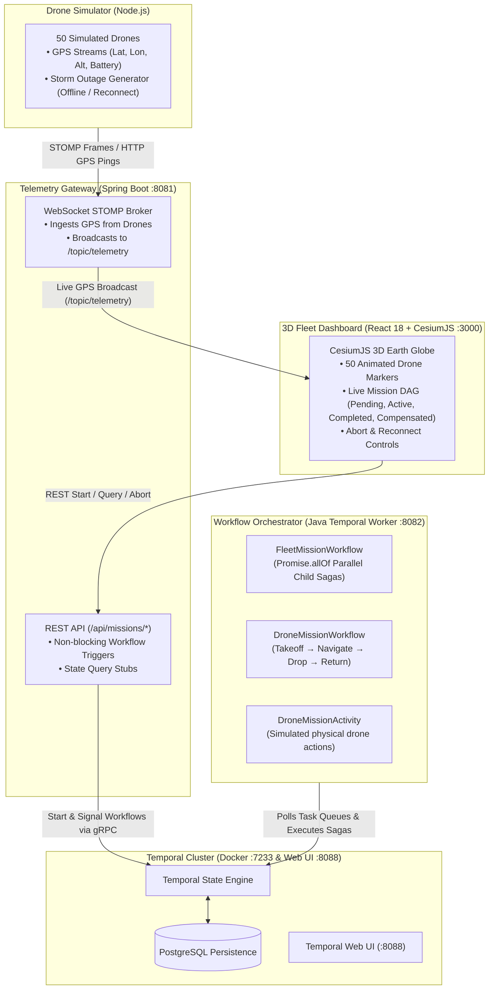

# AeroSaga: Autonomous Drone Mission Control
## Internship Master Blueprint & Team Operating Guide

---

## 1. Executive Summary & Problem Statement

### The Problem
Traditional Java REST APIs are **stateless and synchronous**. 
- In enterprise logistics, autonomous drone delivery operations are **long-running, multi-step distributed sagas** (e.g. 45-minute flight from warehouse takeoff $\rightarrow$ navigation across urban waypoints $\rightarrow$ precision package drop $\rightarrow$ return to home base).
- If a server crashes, if cloud pods restart, or if a drone loses network connection midway during a storm, standard Spring Boot applications lose in-memory thread execution state.
- Traditional recovery requires complicated manual database polling, cron jobs, or error-prone custom state machines.

### The Temporal.io Solution ("Durable Execution")
**Temporal.io** replaces volatile in-memory execution with **durable execution**:
1. Every workflow state transition (every step, activity result, signal, and timer) is recorded durably in Temporal's event history database (PostgreSQL).
2. If a drone goes offline, the Java workflow pauses safely using `Workflow.await(...)` without consuming server threads or polling databases.
3. If the Spring Boot backend server is killed and restarted 2 hours later, Temporal replays the event history and **resumes execution at the exact line of Java code where it paused**.
4. If an activity fails (e.g., customer drop zone obstructed), the workflow triggers **Saga Compensation logic** (e.g., automatically executing "Return to Base" with the payload safe).

---

## 2. System Architecture



---

## 3. Four-Person Team Responsibility Matrix

| Team Member | Module & Title | Primary Tech | Key Deliverables & Weekly Focus |
| :--- | :--- | :--- | :--- |
| **Member 1** | **Temporal Core & Saga Orchestrator** | Java 17, Temporal SDK, JUnit | • **W1**: Takeoff workflow & activity interfaces.<br/>• **W2**: Parent `FleetMissionWorkflow` with `Promise.allOf` parallel child sagas.<br/>• **W3**: Compensation transactions (try/catch `dropPackage()` $\rightarrow$ `returnToBase()`).<br/>• **W4**: `@SignalMethod` (Emergency Abort & Reconnect) and determinism guard. |
| **Member 2** | **Backend & Telemetry Gateway** | Spring Boot 3, WebSocket STOMP, Temporal Client | • **W1**: Spring Boot app skeleton, Temporal client gRPC bean setup.<br/>• **W2**: Non-blocking `WorkflowClient.start()` endpoints & STOMP broker.<br/>• **W3**: `@QueryMethod` REST endpoints with fallback error handlers.<br/>• **W4**: CORS headers, Signal relaying to Temporal cluster. |
| **Member 3** | **Frontend & 3D Visualization** | React 18, CesiumJS, STOMP.js | • **W1**: CesiumJS Earth setup, camera lock on San Francisco fleet.<br/>• **W2**: STOMP client subscription, animated markers with lat/lon interpolation.<br/>• **W3**: Dynamic Mission DAG side-panel with step color coding.<br/>• **W4**: Emergency Abort & Reconnect buttons, offline radar highlights. |
| **Member 4** | **DevOps, Simulation & Resiliency QA** | Docker Compose, Node.js, Shell | • **W1**: Docker Compose setup (Temporal Server + Postgres + Temporal UI).<br/>• **W2**: Node.js 50-drone telemetry simulator (STOMP + HTTP).<br/>• **Mid-Review**: Conduct **Resiliency Audit** (kill gateway mid-flight & prove replay).<br/>• **W4**: Final load test with 50+ drones, presentation slide deck. |

---

## 4. Root Cause of Errors & Fixes Applied

| # | Bug in Previous Generator | Root Cause | Fix Applied |
| :--- | :--- | :--- | :--- |
| **1** | **Non-Deterministic Replay Error** | `FleetMissionWorkflowImpl.java` called `UUID.randomUUID()` in workflow class scope. Temporal replays code deterministically from history; random calls violate replay integrity. | Replaced with `Workflow.randomUUID()` and `Workflow.currentTimeMillis()`. |
| **2** | **HTTP Request Hang / Timeout** | `MissionService.java` called `stub.execute(input)` synchronously in HTTP request thread, blocking for the duration of the entire flight. | Converted to asynchronous, non-blocking startup: `WorkflowClient.start(stub::execute, input)`. |
| **3** | **Broken Query & Signal Stubs** | `MissionService.java` passed `WorkflowOptions` when attaching to existing workflows to query or signal them. | Changed to `workflowClient.newWorkflowStub(DroneMissionWorkflow.class, workflowId)`. |
| **4** | **Sequential Drone Flights** | `FleetMissionWorkflowImpl` executed drones one-by-one in a blocking for-loop instead of parallel orchestration. | Implemented `Async.procedure(child::execute, input)` and `Promise.allOf(...)`. |
| **5** | **WebSocket Protocol Failure** | Simulator sent raw text strings to a STOMP broker; gateway never broadcasted telemetry to `/topic/telemetry`. | Configured STOMP handshake frames, dual SockJS + raw WS endpoints, and `messagingTemplate.convertAndSend("/topic/telemetry", data)`. |
| **6** | **Cesium Global Crash** | `App.js` referenced `Cesium.Cartesian3` and `Cesium.Color` without importing them; billboard 404'd on missing png. | Imported `* as Cesium from 'cesium'`; upgraded to high-performance glowing radar points. |
| **7** | **Unclosed JSX Tags** | `<br>` in `App.js` broke React JSX compilation. | Replaced with valid JSX `<br />`. |

---

## 5. How to Run the Complete System

### Step 1: Start Temporal Cluster (Docker)
1. Ensure **Docker Desktop** is running on your machine.
2. From the root directory:
```powershell
docker compose up -d
```
3. Open `http://localhost:8088` in your browser. You should see the **Temporal Web UI**.

### Step 2: Start Backend Orchestrator (Port 8082)
In a new terminal:
```powershell
cd backend
mvn spring-boot:run
```

### Step 3: Start Gateway Server (Port 8081)
In a new terminal:
```powershell
cd gateway
mvn spring-boot:run
```

### Step 4: Start 3D Fleet Dashboard (Port 3000)
In a new terminal:
```powershell
cd frontend
npm start
```
Open `http://localhost:3000` to view the CesiumJS command globe.

### Step 5: Start the Drone Simulator
In a new terminal:
```powershell
cd simulator
node drone-sim.js
```

### Step 6: Start the Fleet Mission
Click **"Start Fleet (50 Drones)"** on the UI, or trigger via curl:
```powershell
curl -X POST http://localhost:8081/api/missions/start -H "Content-Type: application/json" -d "{}"
```

---

## 6. How to Run the Mid-Project Resiliency Audit

To prove Temporal's durability to your internship mentors:
1. Start a single drone mission:
   ```powershell
   curl -X POST http://localhost:8081/api/missions/drone-0/start -H "Content-Type: application/json" -d '{"startLat":37.7749,"startLon":-122.4194,"destLat":34.0522,"destLon":-118.2437,"altitude":120}'
   ```
2. Check its state (should be `TAKEOFF` or `NAVIGATE`):
   ```powershell
   curl http://localhost:8081/api/missions/drone-0/state
   ```
3. **Kill the Gateway server process**:
   Stop the process or terminate it in terminal.
4. Wait 20 seconds. (Notice in Temporal UI at `http://localhost:8088` that the workflow is **still active and progressing** because Temporal owns the state, not Spring Boot!).
5. **Restart the Gateway**:
   ```powershell
   mvn spring-boot:run
   ```
6. Query the drone state again:
   ```powershell
   curl http://localhost:8081/api/missions/drone-0/state
   ```
7. **Verification**: The step will have advanced to `DROP_PACKAGE` or `RETURN_TO_BASE`. The workflow **never restarted from scratch and zero data was lost**.
