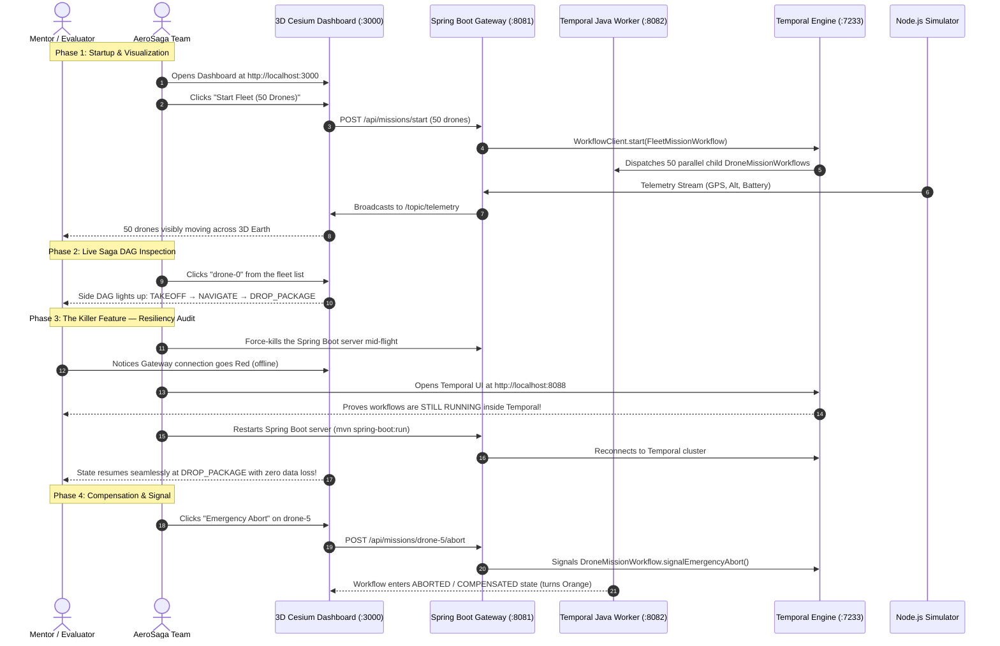

# AeroSaga: Internship Defense, Viva & Demo Guide
## Master Presentation Playbook for Your 4-Member Team

---

## 1. Live Demo Script (Step-by-Step for Reviews)

Follow this sequence during your **Mid-Project Review** and **Final Review** demonstrations.

---

## 2. Team Member Speaking Parts

To ensure each member gets high marks from the evaluator, divide the presentation according to primary ownership:

### **Member 1 (Temporal Core & Orchestration Lead)**
* **What to present:**
  - *"Why standard REST APIs fail for 45-minute drone missions (loss of thread state during server crashes or storm dropouts)."*
  - *"How we used the Temporal Java SDK to model the flight as a durable Saga: Takeoff $\rightarrow$ Navigate $\rightarrow$ Drop $\rightarrow$ Return."*
  - *"Our compensation logic: if `dropPackage()` throws an exception, the workflow catches it and immediately executes `returnToBase()` so the package and drone are never lost."*
  - *"How we orchestrated 50 parallel drones using `io.temporal.workflow.Async` and `Promise.allOf`."*

### **Member 2 (Backend & Telemetry Gateway Lead)**
* **What to present:**
  - *"How the Spring Boot gateway bridges external HTTP/WebSockets with Temporal's gRPC cluster."*
  - *"Why we used `WorkflowClient.start()` instead of synchronous blocking execution, allowing instantaneous HTTP returns for long-running workflows."*
  - *"The STOMP WebSocket broker architecture: how incoming drone GPS pings are ingested and broadcasted to `/topic/telemetry`."*
  - *"How `@QueryMethod` endpoints provide real-time workflow status directly from Temporal's state engine without polling a custom SQL database."*

### **Member 3 (Frontend & 3D Visualization Lead)**
* **What to present:**
  - *"The CesiumJS 3D Earth visualization engine rendering high-frequency GPS feeds."*
  - *"How we implemented linear interpolation (`lat + (target - lat) * t`) to ensure 50 drones move smoothly at 60 FPS without jitter."*
  - *"The interactive **Mission DAG side-panel**: color-coded step status (`PENDING` = gray, `ACTIVE` = cyan, `COMPLETED` = green, `COMPENSATED` = orange, `FAILED` = red)."*
  - *"Interactive control buttons triggering Emergency Aborts and Reconnect signals dynamically."*

### **Member 4 (Simulation, Testing & DevOps Lead)**
* **What to present:**
  - *"The Docker Compose infrastructure orchestrating Temporal Server, PostgreSQL, and Temporal Web UI."*
  - *"The Node.js multi-drone simulator generating realistic GPS physics, battery depletion, and stochastic storm outages."*
  - *"The **Resiliency Audit** demonstration: live killing of server infrastructure mid-flight, showing zero state loss upon reboot."*
  - *"Automated one-click orchestration via PowerShell scripts (`start-all.ps1` and `test-resiliency.ps1`)."*

---

## 3. High-Yield Viva / Technical Defense Questions

Be prepared for these standard questions that senior engineers and professors love to ask about Temporal:

### Q1: *"Why use Temporal instead of Kafka or RabbitMQ?"*
> **Answer:** *"Kafka and RabbitMQ are **message streaming queues**, not stateful workflow orchestrators. While Kafka can deliver a message, you still have to manually build database tables, state transition machines, retry timers, and recovery logic in your application code. Temporal provides **Durable Execution** out-of-the-box: your plain Java code itself is the state machine. If the server dies, Temporal remembers the exact line of code and variable values upon restart."*

---

### Q2: *"What is the difference between a Workflow and an Activity in Temporal?"*
> **Answer:** 
> - **Workflow**: Must be **100% deterministic**. It defines the business logic, step sequence, and state transitions. It cannot make direct network calls, query system clocks (`System.currentTimeMillis()`), or generate random numbers (`Math.random()`), because it will be replayed.
> - **Activity**: The unit of **non-deterministic work and side-effects** (e.g. talking to drone hardware, making REST calls, database writes, or `Thread.sleep`). Temporal automatically manages timeouts, heartbeats, and exponential retry policies on Activities.

---

### Q3: *"What is Temporal Workflow Replay, and why must workflows be deterministic?"*
> **Answer:** *"When a worker restarts or recovers a workflow, Temporal re-executes the workflow Java code from line 1. When it reaches an Activity that previously succeeded, it does not re-execute the physical activity; instead, it looks up the saved result in PostgreSQL and immediately returns it. If the workflow code used non-deterministic logic (like Java's `UUID.randomUUID()`), the replayed code would take a different path than what was recorded in history, resulting in a fatal `NonDeterministicWorkflowError`."*

---

### Q4: *"What is a Saga pattern and how is compensation implemented in AeroSaga?"*
> **Answer:** *"A Saga is a sequence of local transactions where each step has a compensating transaction to undo the action if a subsequent step fails. In our `DroneMissionWorkflowImpl`, if the `dropPackage()` activity fails (e.g. delivery zone blocked), the exception is caught, and the workflow executes the `returnToBase()` compensating activity, marking the mission state as `COMPENSATED` rather than leaving the drone stranded."*

---

### Q5: *"How do Signals and Queries differ in Temporal?"*
> **Answer:** 
> - **Signal (`@SignalMethod`)**: An asynchronous message sent to a **running** workflow from the outside world to alter its state (e.g. clicking 'Emergency Abort' or when a drone reconnects after a storm).
> - **Query (`@QueryMethod`)**: A synchronous, read-only inspection of the workflow's internal memory state (e.g. querying current battery, step, and status) without modifying workflow history.

---

### Q6: *"How does the workflow handle a drone dropping offline in a storm without spinning in a busy CPU loop?"*
> **Answer:** *"We use Temporal's `Workflow.await(() -> reconnectReceived)`. When a drone goes offline, `Workflow.await` suspends the workflow execution in the Temporal engine. It consumes zero CPU cycles and zero server threads while suspended. When the drone reconnects, the `@SignalMethod` sets the condition to true, and Temporal wakes up the workflow immediately."*

---

## 4. Key Metrics to Highlight to Mentors

- **50 Concurrent Autonomous Agents**: Handled smoothly on a single laptop.
- **Zero Thread Exhaustion**: Asynchronous Temporal stubs require no long-running thread pools on the gateway.
- **Zero Data Loss Guarantee**: Resiliency proven through manual process killing.
- **Sub-Second Telemetry Latency**: Real-time STOMP WebSockets at 250ms update intervals.
